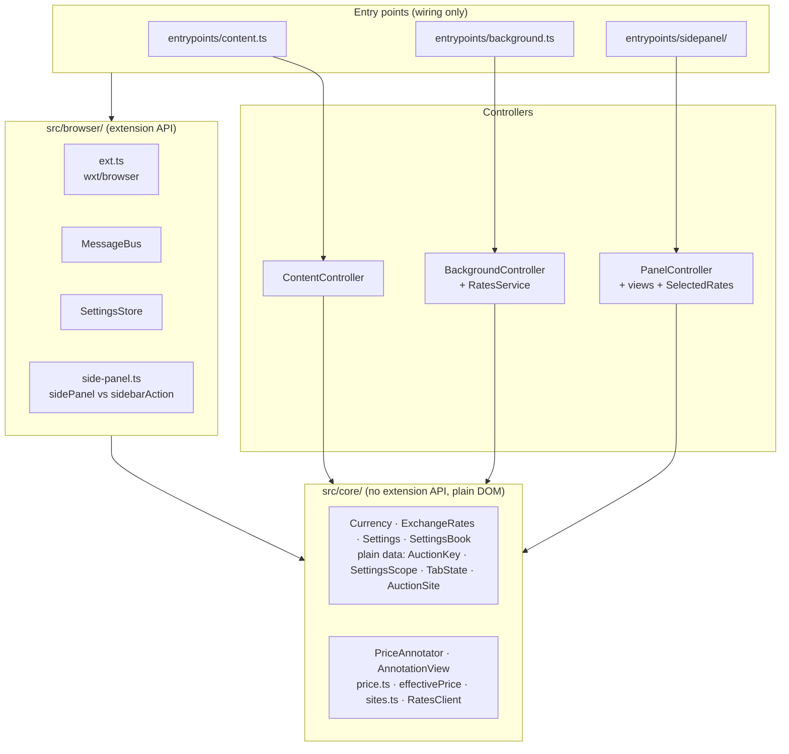
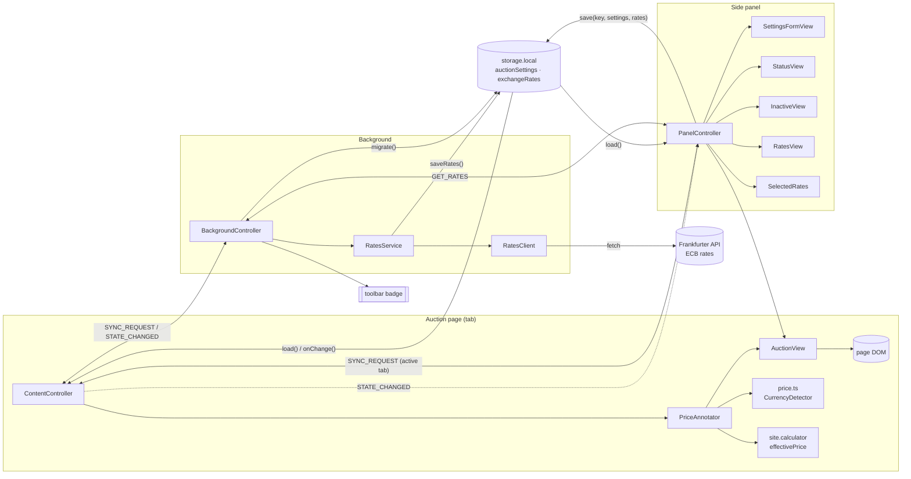
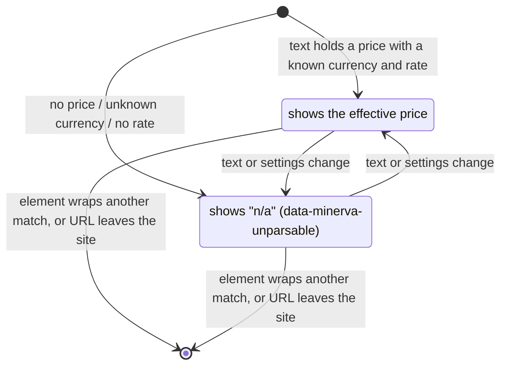
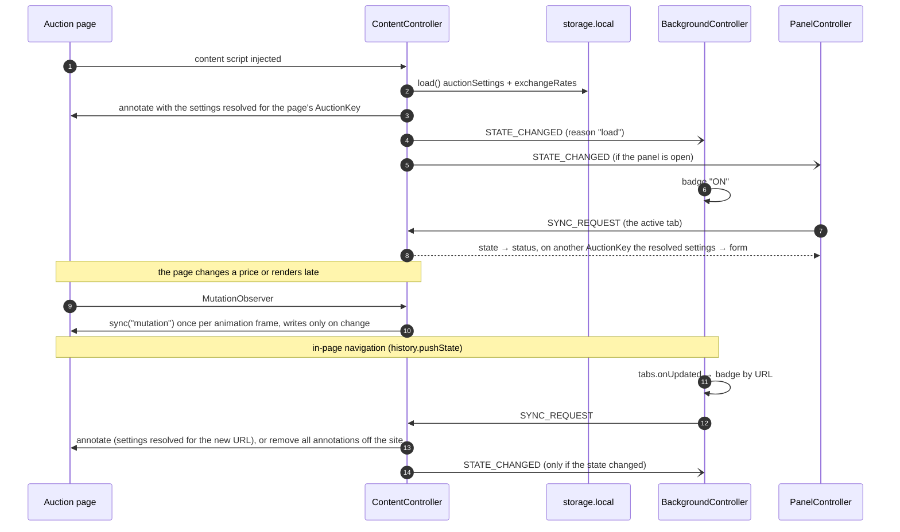
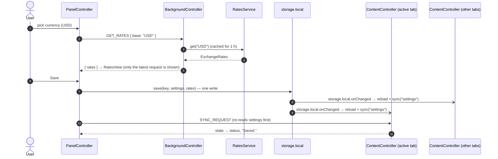
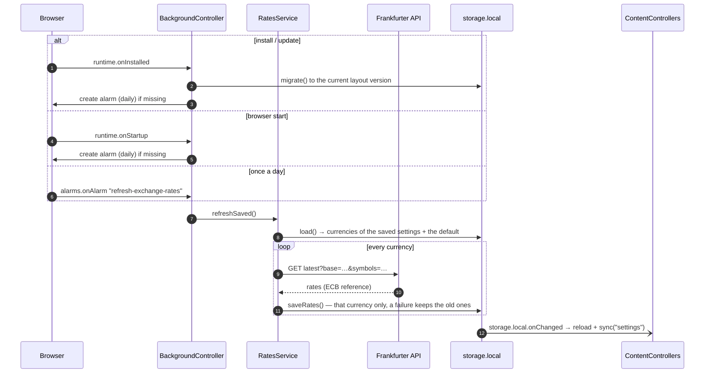
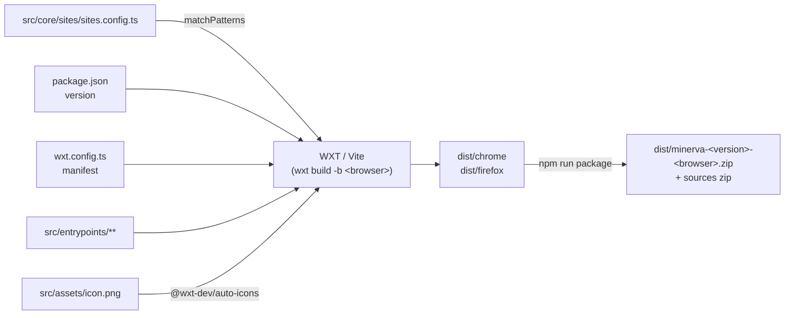

# Architecture

Minerva is a Manifest V3 WebExtension for Chrome and Firefox. It runs in three separate JavaScript contexts that only talk to each other through **runtime messages** and **`storage.local`**:

| Context | Entry point | Controller | Runs … |
| --- | --- | --- | --- |
| **Content script** | `src/entrypoints/content.ts` | `ContentController` | in every tab on a configured auction site (injected by the manifest) |
| **Background** | `src/entrypoints/background.ts` | `BackgroundController` | once per browser: Chrome service worker, Firefox event page |
| **Panel** | `src/entrypoints/sidepanel/main.ts` (+ `index.html`) | `PanelController` | while the side panel (Chrome) / sidebar (Firefox) is open |

Each entry point only *wires things up*: it creates its controller with the real browser objects (`window`/`document`, `ext`, `MessageBus`, `SettingsStore`) and calls `start()`. All behaviour lives in the controllers, which get every dependency through their constructor and are therefore tested with jsdom and fakes (`test/*-controller.test.ts`).

## Layers



| Layer | Rule |
| --- | --- |
| `src/core/` | Never touches an extension API; works on plain strings and a plain `Document`. Unit tested with jsdom. |
| `src/browser/` | The only code using `chrome.*` / `browser.*`. Classes take `ext` as constructor argument, so they are testable with a fake - except `SettingsStore`, which uses WXT's storage (`wxt/utils/storage`, bound to the global extension API) and is tested with WXT's `fakeBrowser` (which `WxtVitest()` puts in place of the extension API in every test). `ext.ts` re-exports `wxt/browser` and is therefore only imported by entry points. |
| Controllers | Behaviour of one context; everything injected. |
| Entry points | Create the controller with the real objects. |
| `wxt.config.ts` (`manifest`) | The only other place where Chrome and Firefox differ. |

## Components and dependencies



### Source layout

```
src/
  core/        browser-agnostic logic
    config.ts      plugin-wide constants
    regexp.ts      RegExp escaping and the "*"-only glob used for paths and currency tokens
    settings/      Settings (ranges, validation of the panel settings), AuctionKey (site +
                   house + auction), SettingsBook (settings saved per key, lookup),
                   SettingsScope + SETTINGS_SCOPES (the lookup order)
    pricing/       PriceCalculator (the function type, per site), effectivePrice (the default)
    rates/         ExchangeRates (rates for one base, conversion), RatesClient (Frankfurter / ECB)
    currency/      Currency (the supported currencies: code, symbol, tokens),
                   CurrencyDetector (finds the currency next to a price)
    price.ts       price parsing, conversion, re-formatting
    annotation/    PriceAnnotator (reads and prices the elements),
                   AnnotationView (inserts/updates the sibling, idempotent)
    sites/         sites.ts (AuctionSite, defineSite, findSite, identify: house / auction IDs
                   out of a URL, matchPatterns), sites.config.ts (the targeted sites)
    messages.ts    message types
    state/         TabState (what the extension does in a tab: active, counts, price
                   currencies, site, house and auction IDs)
  browser/     the thin browser abstraction (API alias, messaging, settings storage,
               side panel vs. sidebar)
  entrypoints/ the WXT entry points, wiring only: background.ts, content.ts,
               sidepanel/ (index.html + main.ts)
  background/  background script / service worker (BackgroundController, RatesService)
  content/     content script (ContentController) + the annotation stylesheet
  panel/       side panel UI (Bootstrap): PanelController, views/, SelectedRates
  assets/      icon.png (source of the generated icons/<size>.png), minerva-64.png
               (inlined into content.css)
wxt.config.ts  build and manifest for both browsers (WXT)
test/          Vitest (+ WxtVitest, jsdom): core units, browser layer and controllers
               (fakes in test/support/)
```

### Controllers and their dependencies

| Controller | Constructor dependencies | Responsibilities |
| --- | --- | --- |
| `ContentController` | `window`, `bus`, `store`, `sites` (default `SITES`), `annotator` (default `PriceAnnotator`), `isValid` | Load settings and rates, annotate the page with the settings resolved for its `AuctionKey` (on every sync), re-sync on navigation/DOM/settings changes, answer `SYNC_REQUEST`, report `STATE_CHANGED` |
| `BackgroundController` | `ext`, `bus`, `store`, `rates` (`RatesService`), `sites` | Toolbar badge, `SYNC_REQUEST` to a tab on navigation, answer `GET_RATES`, storage migration, rates refresh schedule |
| `PanelController` | `document`, `tabs`, `bus`, `store`, `sites` | Ask the active tab for its state (`SYNC_REQUEST`, by URL without a content script), show the settings resolved for its auction (reloaded when its `AuctionKey` changes) and save them under that key, show rates of the selected currency, show the active tab's status |

| Helper | Owned by | Purpose |
| --- | --- | --- |
| `RatesService` | Background | The only user of `RatesClient`; one-hour cache for the panel's requests, refreshes the saved rates of every currency in use |
| `SelectedRates` | Panel | Rates of the currency picked in the panel; a newer request supersedes older ones |
| `PriceAnnotator` / `AnnotationView` | Content | *What* to show (wrapper rule, pricing) / the only class writing to the page, only on change |
| `MessageBus` | all | `on(type, handler)` dispatch; returns `true` for async answers so the channel stays open |
| `SettingsStore` | all | `load()` → `{ book, rates }` in one read, `save(key, settings, rates)` in one write, `saveRates()`, `onChange()` (once per changed key) → unsubscribe, `migrate()`; WXT storage items `local:auctionSettings`, `local:exchangeRates`, `local:storageVersion` |

## HTML components

### Side panel (`src/entrypoints/sidepanel/index.html`)

The panel is a single Bootstrap page shared by both browsers. Its DOM is only touched through its view classes:

| Element (`id`) | Content | View | User events → controller |
| --- | --- | --- | --- |
| `#settings` (form) | the settings form, *Save* button | `SettingsFormView` | `submit` → `PanelController.save()` |
| `#currency` (select) | options built from `Currency.CODES` | `SettingsFormView` | `change` → `PanelController.selectCurrency()` |
| `#auction-premium` (input) | premium in %, `min`/`max` from `Settings.RANGES` | `SettingsFormView` | `input` → clears the invalid marker |
| `#shipment` (input) | shipping cost, `min` from `Settings.RANGES` | `SettingsFormView` | `input` → clears the invalid marker |
| `#shipment-currency` | the currencies of the active tab's prices (`TabState#currencies`, "–" for none), which the shipment is entered in | `SettingsFormView` | – |
| `#saved` | "Saved." note, hidden after 2 s | `SettingsFormView` | – |
| `#auction-ids` (`#auction-house`, `#auction-id`), top of the panel | house and auction ID from the URL, "unknown" when not found; shown together with `#settings` | `AuctionView` | – |
| `#settings-source`, below the IDs | "Values from" pills, one per `SETTINGS_SCOPES` entry plus *Defaults*; the one the form's values come from is highlighted (`aria-current`, tooltip "Saved for this auction house.") | `AuctionView` | – |
| `#inactive` (`#inactive-text`) | Minerva saying "?", "No auction or platform active" (inactive) / "No auction detected on this page" (on a site, but no house or auction ID in the URL); shown instead of `#settings` unless the active tab is on an auction (`TabState#onAuction`: active with a house or auction ID; the form stays hidden until the state is known) | `InactiveView` | – |
| `#status` (badge) | "3 prices annotated, 1 n/a" / "inactive" | `StatusView` | – |
| `#rates` (table body), `#rates-info` | "1 GBP = 1.16 EUR" rows, source date / "Loading…" / error | `RatesView` | – |

### Injected annotation (content script)

For every price element on a configured site, `AnnotationView` inserts one sibling right after it:

```html
<span class="current-bid">USD 1.359</span>
<span class="minerva-effective-price" aria-live="polite" data-minerva-source="USD 1.359">EUR 779,50</span>
```

| Part | Meaning |
| --- | --- |
| same tag as the price element | flows like the price itself |
| `class="minerva-effective-price"` | `ANNOTATION_CLASS`; styled by `content.css` as a speech bubble with Minerva (`::before`) and its tail (`::after`), so the DOM stays one element; never read back as a price |
| `data-minerva-source` | the price text the result was computed from |
| `data-minerva-unparsable` | present while the annotation shows `n/a` (greyed out) |



## Messages

Three message types, defined in `src/core/messages.ts` and sent through `MessageBus`. `Protocol` in the same file types each one's payload and answer; `MessageBus.on/send/sendToTab` are generic over it, so senders and handlers cannot drift apart:

| Type | From → to | Payload | Answer | Sent when |
| --- | --- | --- | --- | --- |
| `SYNC_REQUEST` | background or panel → content (`tabs.sendMessage`) | – | `{ url, active, annotated, unparsable, currencies, site, house, auction }` after re-reading the settings and syncing | a tab navigates (`tabs.onUpdated`, background); the panel opens, saves, or sees a tab switch, navigation or `STATE_CHANGED` (to the active tab) |
| `STATE_CHANGED` | content → background + panel | `{ url, active, annotated, unparsable, currencies, site, house, auction, reason }` | – | a sync changed the tab's `TabState` |
| `GET_RATES` | panel → background | `{ base }` | `{ rates }` (`ExchangeRates#toJSON()`) or `{ error }` | panel opens, a currency is picked |

Messages are structured-cloned, so they carry plain data: a `TabState` is plain data already and is sent as it is, rates as `ExchangeRates#toJSON()`. Receivers validate what arrives with `TabState.from()` / `ExchangeRates.fromJSON()`.

## Storage

Everything is stored in `storage.local` through `SettingsStore`, which defines one WXT storage item per key (`storage.defineItem("local:…")`); there is no message for settings, storage is the channel. A read is one `storage.local.get` (`storage.getItems`), a save one `storage.local.set` (`storage.setItems`) of settings, rates and layout version.

| Key | Value | Written by | Read by |
| --- | --- | --- | --- |
| `auctionSettings` | `[{ site, house, auction, settings: { auctionPremium, shipment, currency } }]` (`SettingsBook#toJSON()`), oldest first, one entry per key | panel on Save | content script, panel, background (currencies to refresh) |
| `exchangeRates` | `{ [base]: { base, date, rates } }` (`ExchangeRates#toJSON()` per currency; `1 base = rates[code] code`) | panel on Save (with the settings, one write), background on refresh | content script |
| `storageVersion` | layout version of the two keys above (`SettingsStore.VERSION`, currently 1; missing = 1) | panel on Save, background on install/update (`migrate()`) | every `load()` |

The settings of a page are found by `SettingsBook#resolve()`, which tries `SETTINGS_SCOPES` (auction, then house, then site; see [Configuration](configuration.md#which-saved-settings-apply)); without a match the defaults apply. Without stored rates for a currency, only prices already in it are converted.

A layout change raises `SettingsStore.VERSION` and adds a function to `SettingsStore.MIGRATIONS` that turns the values of the previous version into the new one (none exist yet). Every `load()` applies the missing migrations in memory, so all contexts read the current layout even before the stored data is converted; the background's `migrate()` on `runtime.onInstalled` writes the converted data and the version once. It is a small runner of our own over both keys rather than WXT's per-item versioning, because `storage.setItems()` - our one-write save - stores no WXT version metadata.

## Lifecycles

### Events per context

| Context | Event | Reaction |
| --- | --- | --- |
| Content | script injected (`document_idle`) | `start()`: load settings/rates, register listeners, `sync("load")`, observe the DOM |
| Content | `MutationObserver` (`childList`, `characterData`, whole document) | one `sync("mutation")` per animation frame |
| Content | `popstate`, `hashchange` | `sync("popstate")` / `sync("hashchange")` |
| Content | `storage.local.onChanged` of `auctionSettings` or `exchangeRates` (WXT `item.watch()`, once per changed key) | reload settings/rates, `sync("settings")` |
| Content | `SYNC_REQUEST` | reload settings/rates, `sync("request")`, answer the state |
| Content | WXT `ctx.onInvalidated` (extension reloaded/updated/removed, or a newer copy of the script started in the tab) | `stop()`: disconnect the observer, cancel the pending frame, remove the listeners, `bus.off()`, unsubscribe from storage, remove all annotations |
| Background | `runtime.onInstalled` | migrate the stored layout (records its version), schedule the daily alarm, refresh the saved rates |
| Background | `runtime.onStartup` | schedule the alarm if missing (Firefox drops alarms on restart), refresh the saved rates |
| Background | `alarms.onAlarm` (`refresh-exchange-rates`, daily) | refresh the saved rates |
| Background | `tabs.onUpdated` (`url` changed or `status: complete`) | badge by URL, `SYNC_REQUEST` to the tab |
| Background | `STATE_CHANGED` | badge by the reported state |
| Background | `GET_RATES` | answer (see [Messages](#messages)) |
| Background | toolbar button | Chrome: opens the side panel natively; Firefox: `action.onClicked` toggles the sidebar |
| Panel | panel opens | ask the active tab for its state (`SYNC_REQUEST`), show the settings resolved for its auction, load their rates |
| Panel | `#currency` `change` | load the rates of the picked currency |
| Panel | `#settings` `submit` | validate, save settings + rates under the active tab's `AuctionKey`, ask the tab again (it recalculates) |
| Panel | `STATE_CHANGED`, `tabs.onActivated`, `tabs.onUpdated` | ask the active tab again: status and the shipment's currency; on another `AuctionKey`, show the settings resolved for it |

### Content script lifecycle

The content script outlives its extension: after a reload or update the old copy keeps running in open tabs with a dead runtime. WXT's `ContentScriptContext` (`ctx`, passed to `main()`) is invalidated when a newer copy starts in the same tab (it announces itself with a DOM event) or when `ctx.isValid` is read while `runtime.id` is gone; `content.ts` then calls `ContentController#stop()`. Nothing polls `ctx.isValid` by itself, so the controller asks it (its `isValid` dependency) before each sync caused by the page - the first DOM change, `popstate` or `hashchange` after the extension went away tears the old copy down. The controller never sees `ctx`, which keeps it testable without WXT.

```mermaid
stateDiagram-v2
  [*] --> Loading: main(ctx) → start()
  Loading --> Running: settings loaded → listeners, sync("load"), observer
  Loading --> Stopped: stop() before loading finished (no listener is registered)
  Running --> Running: DOM change / popstate / hashchange (isValid) · SYNC_REQUEST · storage change
  Running --> Stopped: ctx.onInvalidated → stop()
  Stopped --> [*]: annotations removed; late syncs return the last state without writing
```



### Page load and navigation



### Changing the settings in the panel



### Exchange rate refresh



## Build time

WXT generates the manifest of each browser from `wxt.config.ts` and the entry points: the version comes from `package.json`, the content script's `matches` and the `host_permissions` from `matchPatterns(SITES)` (read at build time), so the configured sites decide where the content script is injected. Background, content script and side panel keys follow from the files in `src/entrypoints/` - Chrome gets `side_panel` + the `sidePanel` permission and a service worker, Firefox `sidebar_action` and an event page (`background.scripts`). `import.meta.env.BROWSER` is replaced per build, so `side-panel.ts` keeps only its own branch. `manifest.icons` and the `icons/<size>.png` files come from `@wxt-dev/auto-icons`, which scales `src/assets/icon.png` after bundling.


