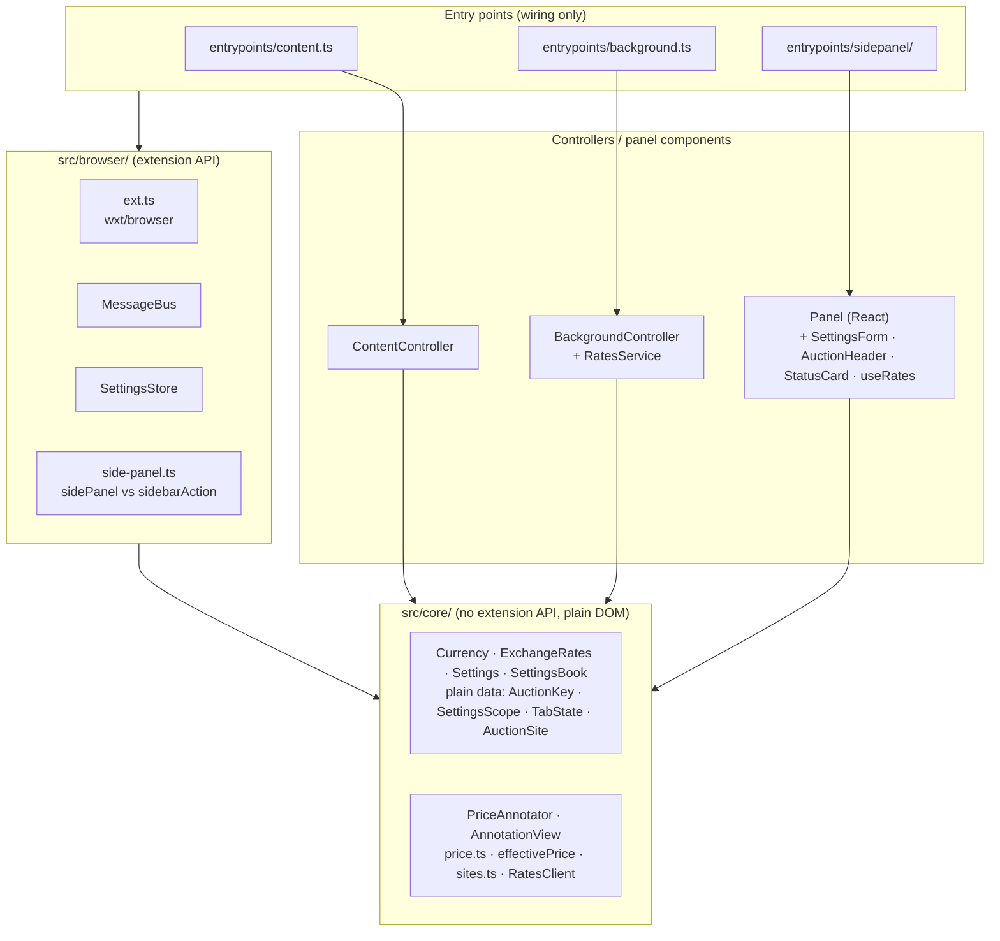
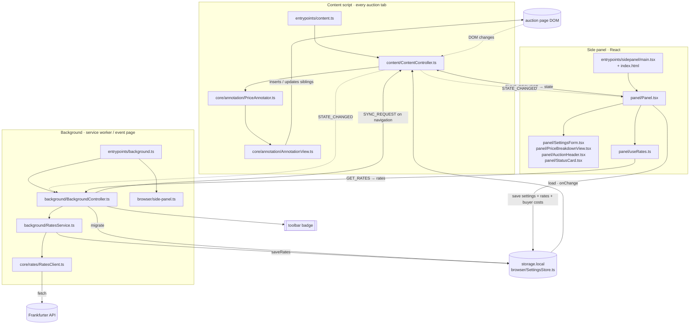
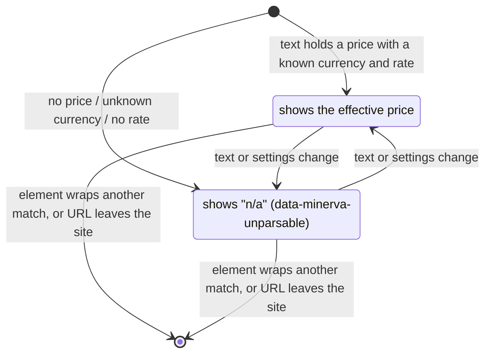
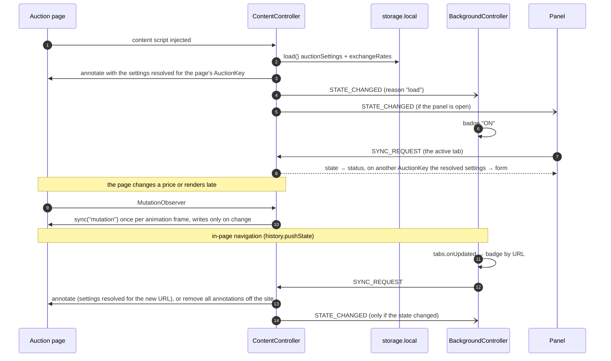
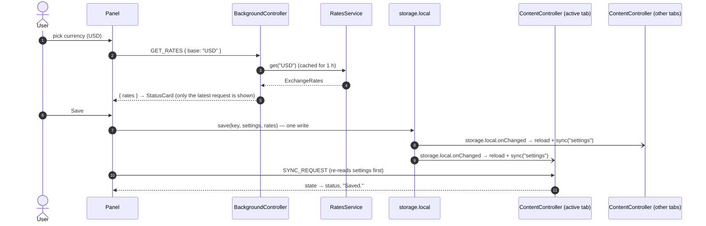
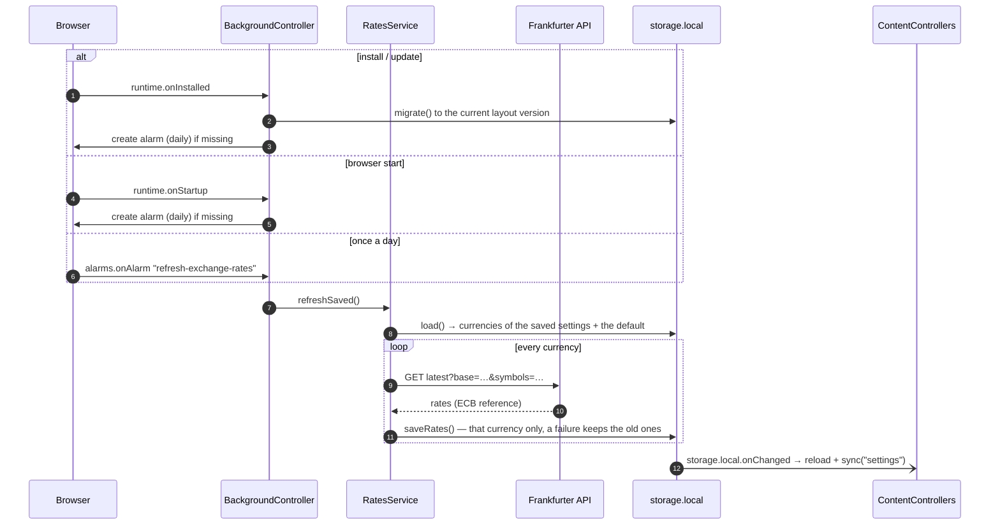
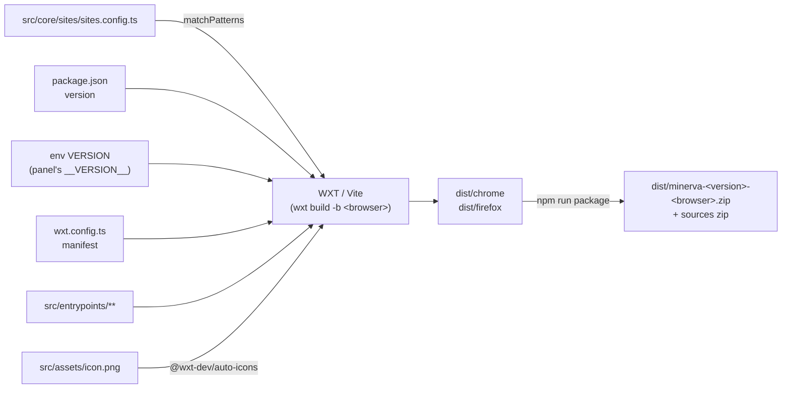

# Architecture

Minerva is a Manifest V3 WebExtension for Chrome and Firefox. It runs in three separate JavaScript contexts that only talk to each other through **runtime messages** and **`storage.local`**:

| Context | Entry point | Controller | Runs … |
| --- | --- | --- | --- |
| **Content script** | `src/entrypoints/content.ts` | `ContentController` | in every tab on a configured auction site (injected by the manifest) |
| **Background** | `src/entrypoints/background.ts` | `BackgroundController` | once per browser: Chrome service worker, Firefox event page |
| **Panel** | `src/entrypoints/sidepanel/main.tsx` (+ `index.html`) | `Panel` (React component) | while the side panel (Chrome) / sidebar (Firefox) is open |

Each entry point only *wires things up*: it creates its controller with the real browser objects (`window`, `ext`, `MessageBus`, `SettingsStore`) and calls `start()` - or, for the panel, renders the `Panel` component with them as props. All behaviour lives in the controllers and components, which get every dependency passed in and are therefore tested with jsdom and fakes (`test/*-controller.test.ts`, `test/panel.test.tsx`).

## Layers



| Layer | Rule |
| --- | --- |
| `src/core/` | Never touches an extension API; works on plain strings and a plain `Document`. Unit tested with jsdom. |
| `src/browser/` | The only code using `chrome.*` / `browser.*`. Classes take `ext` as constructor argument, so they are testable with a fake - except `SettingsStore`, which uses WXT's storage (`wxt/utils/storage`, bound to the global extension API) and is tested with WXT's `fakeBrowser` (which `WxtVitest()` puts in place of the extension API in every test). `ext.ts` re-exports `wxt/browser` and is therefore only imported by entry points. |
| Controllers / `src/panel/` | Behaviour of one context; everything injected (the panel's through props). |
| Entry points | Create the controller (render the panel) with the real objects. |
| `wxt.config.ts` (`manifest`) | The only other place where Chrome and Firefox differ. |

## Components, files and how they work together

Each box is a file (paths relative to `src/`), grouped by the context it runs in. Solid arrows inside a context are calls, the labelled arrows between contexts are messages (dotted: `STATE_CHANGED`, sent without expecting an answer), storage access and the outside world:



What happens along the arrows:

- **On the page**, `content.ts` starts the `ContentController`, which loads the settings and rates from storage, finds the site and auction of the URL and lets `PriceAnnotator` price every price element; `AnnotationView` writes the siblings. DOM changes, in-page navigation, storage changes and `SYNC_REQUEST` trigger the same sync again; a changed state goes out as `STATE_CHANGED`.
- **The panel** asks the active tab for its state (`SYNC_REQUEST`, answered with the tab's `TabState`) whenever it opens, the tab changes or a `STATE_CHANGED` arrives, shows the settings that apply to the tab's auction, loads the picked currency's rates from the background (`GET_RATES`) and saves settings and rates in one write.
- **The background** sets the toolbar badge, sends `SYNC_REQUEST` to a tab that navigates, answers `GET_RATES` from the Frankfurter API (cached for an hour), keeps the saved rates fresh (`saveRates`) and migrates the stored data on install/update. `side-panel.ts` makes the toolbar button open the panel.

Besides their own files, all three contexts import the same shared code:

| Shared files | Used for |
| --- | --- |
| `browser/MessageBus.ts`, `core/messages.ts` | sending and handling the three typed messages |
| `browser/SettingsStore.ts` | reading and writing `storage.local` (settings, buyer costs, rates, layout version) |
| `core/sites/sites.config.ts`, `core/sites/sites.ts` | which sites are targeted; site, house and auction of a URL |
| `core/state/TabState.ts`, `core/settings/*`, `core/rates/ExchangeRates.ts` | the tab's state, the saved settings and their lookup, exchange rates |
| `core/price.ts`, `core/currency/*`, `core/pricing/PriceCalculator.ts` | reading a price, its currency, and the effective price (content script) |

### Source layout

```
src/
  core/        browser-agnostic logic
    config.ts      plugin-wide constants
    regexp.ts      RegExp escaping and the "*"-only glob used for paths and currency tokens
    settings/      Settings (an auction's settings: ranges, validation), BuyerCosts (the
                   buyer's own costs, for every auction), ranges.ts (range check),
                   AuctionKey (site + house + auction), SettingsBook (settings saved per
                   key, lookup), SettingsScope + SETTINGS_SCOPES (the lookup order)
    pricing/       PriceCalculator (the function type, per site), priceBreakdown (the parts),
                   effectivePrice (the default: their total)
    rates/         ExchangeRates (rates for one base, conversion), RatesClient (Frankfurter / ECB)
    currency/      Currency (the supported currencies: code, symbol, tokens),
                   CurrencyDetector (finds the currency next to a price)
    price.ts       price parsing, conversion, re-formatting
    annotation/    PriceAnnotator (reads and prices the elements),
                   AnnotationView (inserts/updates the sibling, idempotent)
    sites/         sites.ts (AuctionSite, defineSite, findSite, identify: house / auction IDs
                   out of a URL, matchPatterns), sites.config.ts (the targeted sites)
    messages.ts    message types and the typed protocol
    state/         TabState (what the extension does in a tab: active, counts, price
                   currencies, site, house and auction IDs)
  browser/     the thin browser abstraction (API alias, messaging, settings storage,
               side panel vs. sidebar)
  entrypoints/ the WXT entry points, wiring only: background.ts, content.ts,
               sidepanel/ (index.html + main.tsx)
  background/  background script / service worker (BackgroundController, RatesService)
  content/     content script (ContentController) + the annotation stylesheet
  panel/       side panel UI (React + Bootstrap CSS): Panel, SettingsForm,
               PriceBreakdownView, AuctionHeader, StatusCard, useRates, panel.css
  globals.d.ts __VERSION__, the build version (set by Vite's define in wxt.config.ts)
  assets/      icon.png (source of the generated icons/<size>.png), minerva-64.png
               (inlined into content.css)
wxt.config.ts  build and manifest for both browsers (WXT)
vitest.config.ts  the test runner (Vitest + WxtVitest)
test/          *.test.ts: core units, browser layer and controllers (jsdom documents, fakes in
               test/support/fakes.ts); panel.test.tsx: the React panel (Testing Library)
```

### Controllers and their dependencies

| Controller | Constructor dependencies | Responsibilities |
| --- | --- | --- |
| `ContentController` | `window`, `bus`, `store`, `sites` (default `SITES`), `annotator` (default `PriceAnnotator`), `isValid` | Load settings, buyer costs and rates, annotate the page with the settings resolved for its `AuctionKey` (on every sync), re-sync on navigation/DOM/settings changes, answer `SYNC_REQUEST`, report `STATE_CHANGED` |
| `BackgroundController` | `ext`, `bus`, `store`, `rates` (`RatesService`), `sites` | Toolbar badge, `SYNC_REQUEST` to a tab on navigation, answer `GET_RATES`, storage migration, rates refresh schedule |
| `Panel` (props) | `tabs`, `bus`, `store`, `sites`, `version` | Ask the active tab for its state (`SYNC_REQUEST`, by URL without a content script), show the settings resolved for its auction (reloaded when its `AuctionKey` changes) and the buyer costs, save them (the settings under that key), show rates of the selected currency, show the active tab's status |

| Helper | Owned by | Purpose |
| --- | --- | --- |
| `RatesService` | Background | The only user of `RatesClient`; one-hour cache for the panel's requests, refreshes the saved rates of every currency in use |
| `useRates` | Panel | Rates of the currency picked in the panel (React hook); a newer request supersedes older ones, Save waits for the latest |
| `PriceAnnotator` / `AnnotationView` | Content | *What* to show (wrapper rule, pricing) / the only class writing to the page, only on change |
| `MessageBus` | all | `on(type, handler)` dispatch; returns `true` for async answers so the channel stays open |
| `SettingsStore` | all | `load()` → `{ book, rates, buyer }` in one read, `save(key, settings, rates, buyer)` in one write, `saveRates()`, `onChange()` (once per changed key) → unsubscribe, `migrate()`; WXT storage items `local:auctionSettings`, `local:exchangeRates`, `local:buyerCosts`, `local:storageVersion` |

## HTML components

### Side panel (`src/panel/`, React)

`index.html` only holds `<div id="root">` and the Firefox sidebar's `manifest.*` meta tags; `main.tsx` renders `<Panel>` into it with the real `tabs`, `MessageBus` and `SettingsStore`. The markup lives in the components, styled with Bootstrap classes (its CSS is imported by `main.tsx`, `panel.css` adds the help toggle, the section headings, the breakdown's toggle and Minerva's idle bubble):

| Component | Shows | State and events |
| --- | --- | --- |
| `Panel` | everything below; the form and the header only while the active tab is on an auction (`TabState.onAuction()`: active with a house or auction ID), otherwise Minerva saying "?" with "No auction or site active" (inactive) / "No auction detected on this page" - neither until the tab's state is known | the active tab's `TabState`, the shown settings and their scope, the picked currency; asks the tab on open, on `STATE_CHANGED`, `tabs.onActivated`, `tabs.onUpdated`; `save()` |
| `AuctionHeader` | house and auction ID from the URL ("unknown" when not found); "Values from" pills, one per `SETTINGS_SCOPES` entry plus *Defaults*, the one the form's values come from highlighted (`aria-current`, tooltip "Saved for this auction house.") | – |
| `SettingsForm` | section *This auction*: currency (options from `Currency.CODES`), effective auction premium (%), shipment with the currencies of the page's prices next to it ("–" for none), lots won, the switch *VAT on the hammer price* revealing the hammer price VAT (%, required while on); section *Your costs · all auctions*: the switch *Add import and payment costs* revealing import VAT (%), payment costs (%) and flat fees (in the picked currency); `min`/`max`/`step` from `Settings.RANGES` / `BuyerCosts.RANGES`; a "?" toggle per input for its hint; `PriceBreakdownView`; *Save*, filled while the form differs from the shown values; "Saved." for 2 s | the inputs' text and the switches (an emptied input keeps the shown value), reset when values are shown anew; currency `change` → `onCurrencyChange`, `submit` → validate the rendered inputs → `onSave(settings, buyer)` |
| `PriceBreakdownView` | collapsible (`<details>`) *How a price adds up*: a hammer price of 1,000 in the page's first currency, part by part (`priceBreakdown()`), with the form's current values; parts that are 0 left out | – |
| `StatusCard` | status badge ("3 prices annotated, 1 n/a" / "inactive" / "checking…"), the rates the page needs ("1 GBP = 1.16 EUR"), their date / "Loading…" / "Exchange rates unavailable.", the disclaimer, the build version at the very bottom ("v1.2.3+abc1234", `__VERSION__` from the environment variable `VERSION` at build time, "v0.0.0-dev" without) | – |
| `useRates` (hook) | – | loads the picked currency's rates (`GET_RATES`); a superseded request is dropped, `ratesFor()` waits for the latest for Save |

### Injected annotation (content script)

For every price element on a configured site, `AnnotationView` inserts one sibling right after it:

```html
<span class="current-bid">USD 1.359</span>
<span class="minerva-effective-price" aria-live="polite" data-minerva-source="USD 1.359">EUR 779,50</span>
```

| Part | Meaning |
| --- | --- |
| same tag as the price element | flows like the price itself; a `span` instead for controls (`button`, `a`, `input`, `label`, …), so it never becomes a focusable control or picks up the page's styles for them |
| `class="minerva-effective-price"` | `ANNOTATION_CLASS`; styled by `content.css` as a speech bubble with Minerva (`::before`) and its tail (`::after`), so the DOM stays one element; never read back as a price |
| `data-minerva-source` | the price text the result was computed from |
| `data-minerva-unparsable` | present while the annotation shows `n/a` (greyed out) |
| `data-minerva-align` | `center` / `right` when the price element takes the whole width of its container and aligns its text that way (a centred block, a full-width button): the bubble then sits on its own line below, aligned alike; absent otherwise. Re-checked on every sync (`AnnotationView#alignment()`) |

The bubble is always as wide as its text (`width: fit-content`, no flex growth), also in containers that stretch their children.



## Messages

Three message types, defined in `src/core/messages.ts` and sent through `MessageBus`. `Protocol` in the same file types each one's payload and answer; `MessageBus.on/send/sendToTab` are generic over it, so senders and handlers cannot drift apart:

| Type | From → to | Payload | Answer | Sent when |
| --- | --- | --- | --- | --- |
| `SYNC_REQUEST` | background or panel → content (`tabs.sendMessage`) | – | `{ url, active, annotated, unparsable, currencies, site, house, auction }` after re-reading the settings and syncing | a tab navigates (`tabs.onUpdated`, background); the panel opens, saves, or sees a tab switch, navigation or `STATE_CHANGED` (to the active tab) |
| `STATE_CHANGED` | content → background + panel | `{ url, active, annotated, unparsable, currencies, site, house, auction, reason }` | – | a sync changed the tab's `TabState` |
| `GET_RATES` | panel → background | `{ base }` | `{ rates }` (`ExchangeRates#toJSON()`) or `{ error }` | panel opens, a currency is picked |

Messages are structured-cloned, so they carry plain data: a `TabState` is plain data already and is sent as it is, rates as `ExchangeRates#toJSON()`. Receivers validate what arrives with `TabState.from()` / `ExchangeRates.fromJSON()`.

## Storage

Everything is stored in `storage.local` through `SettingsStore`, which defines one WXT storage item per key (`storage.defineItem("local:…")`); there is no message for settings, storage is the channel. A read is one `storage.local.get` (`storage.getItems`), a save one `storage.local.set` (`storage.setItems`) of settings, rates, buyer costs and layout version.

| Key | Value | Written by | Read by |
| --- | --- | --- | --- |
| `auctionSettings` | `[{ site, house, auction, settings: { auctionPremium, shipment, lotsWon, hammerVat, currency } }]` (`SettingsBook#toJSON()`), oldest first, one entry per key; a missing value reads as its default | panel on Save | content script, panel, background (currencies to refresh) |
| `buyerCosts` | `{ enabled, importVat, paymentCosts, flatFees }` (`BuyerCosts#toJSON()`), one for all auctions; missing = switched off | panel on Save (with the settings, one write) | content script, panel |
| `exchangeRates` | `{ [base]: { base, date, rates } }` (`ExchangeRates#toJSON()` per currency; `1 base = rates[code] code`) | panel on Save (with the settings, one write), background on refresh | content script |
| `storageVersion` | layout version of `auctionSettings` and `exchangeRates` (`SettingsStore.VERSION`, currently 1; missing = 1) | panel on Save, background on install/update (`migrate()`) | every `load()` |

The settings of a page are found by `SettingsBook#resolve()`, which tries `SETTINGS_SCOPES` (auction, then house, then site; see [Configuration](configuration.md#which-saved-settings-apply)); without a match the defaults apply. Without stored rates for a currency, only prices already in it are converted.

A layout change raises `SettingsStore.VERSION` and adds a function to `SettingsStore.MIGRATIONS` that turns the values of the previous version into the new one (none exist yet). Every `load()` applies the missing migrations in memory, so all contexts read the current layout even before the stored data is converted; the background's `migrate()` on `runtime.onInstalled` writes the converted data and the version once. It is a small runner of our own over both keys rather than WXT's per-item versioning, because `storage.setItems()` - our one-write save - stores no WXT version metadata.

## Lifecycles

### Events per context

| Context | Event | Reaction |
| --- | --- | --- |
| Content | script injected (`document_idle`) | `start()`: load settings/rates, register listeners, `sync("load")`, observe the DOM |
| Content | `MutationObserver` (`childList`, `characterData`, whole document) | one `sync("mutation")` per animation frame |
| Content | `popstate`, `hashchange` | `sync("popstate")` / `sync("hashchange")` |
| Content | `storage.local.onChanged` of `auctionSettings`, `exchangeRates` or `buyerCosts` (WXT `item.watch()`, once per changed key) | reload settings/rates/buyer costs, `sync("settings")` |
| Content | `SYNC_REQUEST` | reload settings/rates, `sync("request")`, answer the state |
| Content | WXT `ctx.onInvalidated` (extension reloaded/updated/removed, or a newer copy of the script started in the tab) | `stop()`: disconnect the observer, cancel the pending frame, remove the listeners, `bus.off()`, unsubscribe from storage, remove all annotations |
| Background | `runtime.onInstalled` | migrate the stored layout (records its version), schedule the daily alarm, refresh the saved rates |
| Background | `runtime.onStartup` | schedule the alarm if missing (Firefox drops alarms on restart), refresh the saved rates |
| Background | `alarms.onAlarm` (`refresh-exchange-rates`, daily) | refresh the saved rates |
| Background | `tabs.onUpdated` (`url` changed or `status: complete`) | badge by URL, `SYNC_REQUEST` to the tab |
| Background | `STATE_CHANGED` | badge by the reported state |
| Background | `GET_RATES` | answer (see [Messages](#messages)) |
| Background | toolbar button | Chrome: opens the side panel natively; Firefox: `action.onClicked` toggles the sidebar |
| Panel | panel opens | ask the active tab for its state (`SYNC_REQUEST`), show the settings resolved for its auction, load their rates |
| Panel | currency picked | load the rates of the picked currency |
| Panel | form submitted (*Save*) | validate, save settings + rates under the active tab's `AuctionKey`, ask the tab again (it recalculates) |
| Panel | panel closes (unmount) | remove the `STATE_CHANGED` handler and the `tabs` listeners |
| Panel | `STATE_CHANGED`, `tabs.onActivated`, `tabs.onUpdated` | ask the active tab again: status and the shipment's currency; on another `AuctionKey`, show the settings resolved for it |

### Content script lifecycle

The content script outlives its extension: after a reload or update the old copy keeps running in open tabs with a dead runtime. WXT's `ContentScriptContext` (`ctx`, passed to `main()`) is invalidated when a newer copy starts in the same tab (it announces itself with a DOM event) or when `ctx.isValid` is read while `runtime.id` is gone; `content.ts` then calls `ContentController#stop()`. Nothing polls `ctx.isValid` by itself, so the controller asks it (its `isValid` dependency) before each sync caused by the page - the first DOM change, `popstate` or `hashchange` after the extension went away tears the old copy down. The controller never sees `ctx`, which keeps it testable without WXT.

```mermaid
stateDiagram-v2
  [*] --> Loading: main(ctx) → start()
  Loading --> Running: settings loaded → listeners, sync("load"), observer
  Loading --> Stopped: stop() before loading finished (no listener is registered)
  Running --> Running: DOM change / popstate / hashchange (isValid) · SYNC_REQUEST · storage change
  Running --> Stopped: ctx.onInvalidated → stop()
  Stopped --> [*]: annotations removed; late syncs return the last state without writing
```



### Page load and navigation



### Changing the settings in the panel



### Exchange rate refresh



## Build time

WXT generates the manifest of each browser from `wxt.config.ts` and the entry points: the version comes from `package.json`, the content script's `matches` and the `host_permissions` from `matchPatterns(SITES)` (read at build time), so the configured sites decide where the content script is injected. Background, content script and side panel keys follow from the files in `src/entrypoints/` - Chrome gets `side_panel` + the `sidePanel` permission and a service worker, Firefox `sidebar_action` and an event page (`background.scripts`). `import.meta.env.BROWSER` is replaced per build, so `side-panel.ts` keeps only its own branch. `manifest.icons` and the `icons/<size>.png` files come from `@wxt-dev/auto-icons`, which scales `src/assets/icon.png` after bundling.


